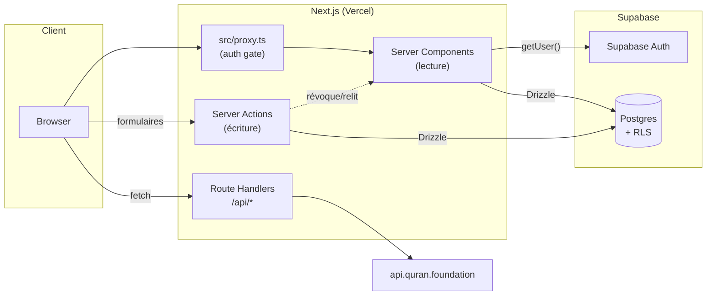

# Architecture

## Vue d'ensemble

Next.js 16 App Router, tout en Server Components par défaut. Il n'y a pas
d'API REST/GraphQL séparée pour les écritures : les mutations passent par des
**Server Actions** (`"use server"`) appelées directement depuis les
formulaires. Les seules routes API (`src/app/api/**`) exposent des ressources
qui doivent être fetchées côté client ou par un service externe (audio Coran,
cron).



## Pourquoi `src/proxy.ts` et pas `middleware.ts`

Ce dépôt tourne sur une version de Next.js où l'ancien `middleware.ts` a été
renommé `proxy.ts` (voir `AGENTS.md` — c'est le genre de changement qui n'est
pas dans les données d'entraînement d'un LLM standard). C'est le seul point
d'entrée qui tourne sur **chaque** requête, avant même les Server Components :
il rafraîchit la session Supabase (`src/lib/supabase/proxy.ts`) et redirige
vers `/login?next=...` les visiteurs non connectés sur toutes les pages
réservées (dashboard, compte, catalogue, recherche, mémorisation). Chaque page
vérifie en plus ce que l'utilisateur a le droit de voir
(`getContentAccess()`). Voir [`auth.md`](./auth.md).

## Route groups

`src/app/` utilise deux route groups qui ne changent pas l'URL mais isolent
deux layouts et deux publics différents :

- **`(public)/`** — le site côté étudiant, avec le layout public. Ouverts
  sans compte : accueil (vitrine), `/coran` et `/rejoindre` (inscription à
  une classe par code). Le reste exige un compte et n'affiche que le contenu
  débloqué pour les classes de l'étudiant : `/cours`, `/thematiques`,
  `/ressources`, `/quiz`, `/hadiths`, `/seances`, `/recherche`,
  `/memorisation`, `/compte`. Voir
  [`domain.md`](./domain.md#accès-au-contenu).
- **`(dashboard)/dashboard/`** — l'admin, protégé par `proxy.ts` +
  une double vérification de rôle dans
  `src/app/(dashboard)/dashboard/layout.tsx` (un `viewer` qui y accède est
  renvoyé vers `/?welcome=1`, jamais informé de l'existence du dashboard). Une entité "Foo" y a
  systématiquement le même quatuor de pages :
  `dashboard/foo/page.tsx` (liste), `dashboard/foo/new/page.tsx` (création),
  `dashboard/foo/[id]/edit/page.tsx` (édition), plus un composant `foo-form.tsx`
  et `foo-table.tsx` partagés entre create/edit et list. `quiz` est la seule
  exception : `createQuiz` redirige vers une cinquième page,
  `dashboard/quiz/[id]/questions/page.tsx`, dédiée à la gestion des questions
  et choix imbriqués. `classes` (admin seulement) n'a pas de page `edit` :
  `dashboard/classes/[id]/page.tsx` réunit le formulaire, le suivi des
  étudiants, les cours, le code d'invitation et la liste des étudiants. Voir [`how-to.md`](./how-to.md) pour dupliquer ce
  pattern sur une nouvelle entité.

Chaque groupe a son propre `layout.tsx` — pas de layout racine partagé au-delà
de `src/app/layout.tsx` (police, thème, `<html>`).

## Couches côté serveur (`src/lib/`)

Le flux de données suit toujours le même sens :

```
page.tsx (Server Component)
   │  appelle
   ▼
lib/db/queries/<entité>.ts   ── lecture, aucune vérification d'auth
   │  utilise
   ▼
lib/db/index.ts (client Drizzle) ──▶ Postgres (RLS s'applique quand même)

formulaire (Client Component) ──appelle──▶ lib/actions/<entité>.ts ("use server")
                                              │
                                              ├─▶ lib/auth/get-session.ts (requireContributor/requireAdmin)
                                              ├─▶ zod: validation des champs
                                              ├─▶ Drizzle: insert/update/delete
                                              └─▶ revalidatePath(...) + redirect(...)
```

Règles implicites à connaître :

- **`lib/db/queries/*`** ne fait jamais de contrôle d'accès — c'est le rôle de
  Postgres RLS (lecture publique sur tout le contenu, voir
  [`database.md`](./database.md)) et de `lib/actions/*` pour l'écriture.
- **`lib/actions/*`** commence toujours par un `requireContributor()` ou
  `requireAdmin()` (`lib/auth/get-session.ts`) avant toute mutation — c'est une
  défense en profondeur, pas la barrière principale (RLS l'est).
- Après une mutation, l'action appelle `revalidatePath()` sur toutes les
  routes publiques qui affichent la donnée (liste dashboard + page publique +
  accueil), puis `redirect()`. Il n'y a pas de client-side cache/store séparé
  (pas de React Query, pas de Zustand) : Next revalide et rerend.

## `src/components/`

- **`components/ui/`** — primitives shadcn/ui génériques (Button, Dialog,
  Table...), pas de logique métier.
- **`components/dashboard/`** — formulaires et tables de l'admin, un fichier
  par entité (`cours-form.tsx`, `cours-table.tsx`, etc.), plus des utilitaires
  partagés (`sortable-reorder-list.tsx` pour le drag & drop d'ordre via
  `@dnd-kit`, `markdown-editor-field.tsx`).
- **`components/public/`** — le site vitrine : `quran-reader.tsx` (le plus
  gros composant du repo, voir [`domain.md`](./domain.md#lecteur-du-coran)),
  `quran-audio-player.tsx` (lecture + surbrillance mot-à-mot),
  `memorization-workspace.tsx` (page `/memorisation`, assemble
  `memorization-dashboard.tsx` = mini tableau de bord,
  `memorization-summary.tsx` = liste des 114 sourates et
  `memorization-progress-bar.tsx` = frise verset par verset, voir
  [`domain.md`](./domain.md#lecteur-du-coran)),
  `quiz-attempt.tsx` / `quiz-item.tsx` (passage de quiz),
  `roadmap-track.tsx` (feuille de route de l'accueil, voir
  [`domain.md`](./domain.md#feuille-de-route)), recherche (`search-command.tsx`),
  suivi de progression (`next-chapter-button.tsx`, `progress-ring.tsx`).
- **`components/layout/`** — header/footer/nav partagés entre pages publiques,
  thème (dark/light via `next-themes`).

## Rendu Coran / Tajweed

Le lecteur du Coran (`components/public/quran-reader.tsx`) fait plus de 1200
lignes car il gère : pagination façon mushaf, police QCF spécifique
(`lib/quran/qcf-font.ts`), coloration tajweed, navigation surah-à-surah,
reprise de la dernière position lue (`localStorage`), mode Zen plein écran
(`@base-ui/react/dialog`), suivi de mémorisation verset par verset (menu
contextuel + `lib/actions/memorization.ts`), et un lecteur audio
(`quran-audio-player.tsx`) branché sur `api/quran/chapter-audio/[chapter]` et
`api/quran/verse-audio/[chapter]` (timing mot-à-mot pour la surbrillance
pendant la lecture), affiché en barre plein écran fixée en bas de l'écran. Les
données viennent de l'API Quran Foundation via `lib/quran/client.ts` (OAuth2
client-credentials, jamais appelée depuis le client — voir les commentaires
du fichier). Détail fonctionnel dans
[`domain.md`](./domain.md#lecteur-du-coran).

Piège connu : le champ `pages` des chapitres de l'API sous-estime parfois la
dernière page d'une sourate (Ash-Sharh, 94, est annoncée sur la page 596 alors
que les versets 3 à 8 sont sur la 597). Le lecteur ne s'y fie donc pas : une
sourate est « complètement chargée » quand son **dernier verset** est affiché
(`chapterFullyLoaded`), et c'est la même règle qui décide du centrage des
sourates tenant sur une seule page.

## Metadata / SEO

`lib/metadata.ts` centralise la génération des `<meta>` (titre, description,
Open Graph). Le site n'a qu'**une** image de partage, `src/app/opengraph-image.tsx`
(API `ImageResponse` de Next) : le logo « طالب » en brun sur fond crème et la
description par défaut, « La plateforme de cours du programme Bayān. ». C'est
l'aperçu qui s'affiche quand on colle un lien dans WhatsApp, par exemple. Le
logo y est un tracé SVG (`lib/logo-path.ts`), pas du texte : le moteur
d'`ImageResponse` lierait mal les lettres arabes.

Les pages réservées (cours, thématiques, hadiths, séances…) n'ont pas d'image
propre : un visiteur non connecté, donc aussi le robot d'un réseau social, est
renvoyé vers `/login`, et c'est l'aperçu de la page de connexion qui s'affiche.

- `src/app/sitemap.ts` — ne liste que les pages ouvertes à tous (accueil,
  `/coran`) : le catalogue est réservé aux étudiants. Il ne lit plus la base.
- `src/app/robots.ts` — autorise l'indexation sauf `/dashboard`, `/compte`, `/rejoindre`,
  `/login`, `/auth` et `/api`, et référence le sitemap.
- Les deux et les Open Graph utilisent `NEXT_PUBLIC_SITE_URL` : si elle n'est
  pas définie sur Vercel, les liens pointent vers `localhost`.

### Icônes et PWA

Les icônes sont des fichiers fixes, pas générés au rendu : le moteur
d'`ImageResponse` lie mal les lettres arabes. Toutes reprennent le logo en
crème (`#f5f5ed`) sur brun (`#21140f`) :

- `src/app/icon.svg` et `src/app/favicon.ico` (16, 32 et 48 px) : le seul
  « ط », lisible dans un onglet ;
- `src/app/apple-icon.png` (180 px) et `public/icon-192.png`,
  `public/icon-512.png` : le mot « طالب » ;
- `public/icon-maskable-512.png` : le même avec plus de marge, déclaré
  `purpose: "maskable"` dans `src/app/manifest.ts`, car Android rogne jusqu'à
  un cercle de 80 %.

Pour les refaire, le texte est mis en forme avec HarfBuzz (`hb-shape`, qui
choisit les formes liées des lettres), les contours des glyphes de
Scheherazade New Bold (la police du logo) sont convertis en tracés SVG avec
fontTools, puis rendus en PNG avec `sharp`. Le manifeste utilise la même
palette : écran de démarrage crème, barre de l'app brune.

## Tests

Vitest (`npm test`), exécuté aussi par la CI. Les tests vivent à côté du code
(`*.test.ts`) et **ne touchent jamais la base** : `@/lib/db`, Supabase et
`next/cache` sont simulés avec `vi.mock`. Ils couvrent la correction des quiz,
les gardes de rôle (dont un test qui vérifie que **chaque** Server Action du
dashboard refuse un utilisateur non autorisé avant de toucher la base), la
progression, la mémorisation, l'accès au contenu et la feuille de route. Voir
[`development.md`](./development.md#tests).
