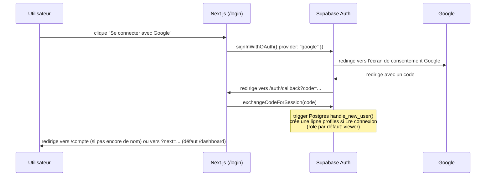

# Authentification & rôles

Auth déléguée entièrement à **Supabase Auth**, deux méthodes possibles — OAuth
Google ou lien magique par e-mail (`signInWithOtp`), pas de mot de passe dans
les deux cas. L'app ne stocke jamais de mot de passe ni de token OAuth.

## Flux de connexion

- Le bouton Google est `components/public/google-login-button.tsx` ; le
  formulaire du lien magique est `components/public/magic-link-form.tsx`
  (`supabase.auth.signInWithOtp({ email })`). Les deux méthodes sont proposées
  sur `/login` et repassent par **la même** route de callback,
  `src/app/auth/callback/route.ts` (`exchangeCodeForSession(code)` fonctionne
  aussi bien pour un code OAuth que pour un code de lien magique).
- Le callback redirige vers `/compte?next=...` (onboarding, saisie du nom) si
  le profil n'a pas encore de `fullName`, sinon directement vers `next` (ou
  `/dashboard` par défaut). Après la saisie du nom, `updateFullNameAction`
  renvoie vers `next`. Un `viewer` qui arrive sur `/dashboard` (valeur par
  défaut quand aucune page n'était demandée, par exemple après un clic sur
  « Connexion » dans l'en-tête) est renvoyé vers `/?welcome=1`, ce qui
  affiche un toast « Bienvenue sur Taalib ! » (`welcome-toast.tsx`).
- La création du profil n'est **pas** faite par le code applicatif : c'est un
  trigger SQL (`handle_new_user`, dans
  `drizzle/migrations/0001_rls_and_profile_trigger.sql`) déclenché à
  l'insertion dans `auth.users`, la table gérée par Supabase. Voir
  [`database.md`](./database.md).
- **Le tout premier compte créé n'est pas admin automatiquement** — il faut le
  promouvoir manuellement (`role = 'admin'`) via l'éditeur de table Supabase ou
  `db:studio`. Tous les comptes suivants naissent `viewer` (défaut de colonne,
  voir `drizzle/migrations/0003_default_viewer_role.sql`) : ils utilisent le
  site public (progression, quiz, mémorisation) sans rien savoir du
  dashboard. Personne n'attend de validation : les élèves arrivent par une
  classe, et un admin ajoute lui-même l'équipe (`contributor` ou `admin`)
  depuis `/dashboard/utilisateurs`.

## `src/proxy.ts` — la porte d'entrée

Dans cette version de Next.js, `middleware.ts` s'appelle `src/proxy.ts` (voir
[`architecture.md`](./architecture.md#pourquoi-srcproxyts-et-pas-middlewarets)).
Il s'exécute sur **chaque** requête (sauf assets statiques, cf. `config.matcher`)
et fait deux choses :

1. Appelle `updateSession()` (`lib/supabase/proxy.ts`) qui rafraîchit les
   cookies de session Supabase — nécessaire car Server Components ne peuvent
   pas écrire de cookies (voir le commentaire dans `lib/supabase/server.ts`).
2. Redirige vers `/login?next=...` si l'utilisateur n'est pas connecté et
   essaie d'accéder à une page réservée (`PROTECTED_PREFIXES` : dashboard,
   compte, tout le catalogue, recherche, mémorisation). Restent ouverts
   l'accueil, `/coran`, `/login`, `/auth` et `/rejoindre`.

C'est une protection au niveau routing, **pas** la barrière de sécurité
principale — voir plus bas.

## Les trois couches de vérification

Il y a volontairement trois niveaux, du plus UX au plus sécurité :

1. **`src/proxy.ts`** — redirige avant même de charger la page. Évite un
   flash de contenu protégé, mais un attacker qui bypasse le routing Next
   (peu probable, mais en théorie) ne serait pas arrêté ici.
2. **`lib/auth/get-session.ts`** (`requireContributor()` / `requireAdmin()`)
   — appelé en tout début de chaque Server Action d'écriture
   (`lib/actions/*.ts`) et dans `dashboard/layout.tsx` pour choisir quoi
   afficher (sidebar complète pour `admin`, redirection vers `/?welcome=1`
   pour `viewer`). Lève une erreur si le rôle ne convient pas. Couvert par des
   tests (`get-session.test.ts`, `authorization.test.ts`).
3. **Row Level Security Postgres** (`is_contributor()`, `is_admin()` dans
   `drizzle/migrations/0001_rls_and_profile_trigger.sql`) — **la vraie
   barrière**. Même si un bug contournait les deux couches précédentes,
   Postgres refuserait la requête. C'est la seule des trois qui protège aussi
   les accès directs à la base (Drizzle Studio, un script one-off, etc.).

Retenir l'ordre : **RLS d'abord**, `requireX()` ensuite pour l'UX (message
d'erreur clair au lieu d'une erreur Postgres brute), `proxy.ts` en dernier
pour éviter un aller-retour serveur inutile.

**Exception importante : la lecture du contenu par les étudiants.** L'app lit
via Drizzle, une connexion Postgres directe qui **ne passe pas par la RLS**.
Ce qu'un étudiant voit est donc décidé côté app par `getContentAccess()`
(`lib/auth/content-access.ts`, voir
[`domain.md`](./domain.md#accès-au-contenu)) : c'est la vraie barrière pour
les lectures, et chaque page ou action qui lit du contenu doit s'en servir.
La RLS, elle, ferme l'API REST Supabase : depuis
`0027_private_content_rls.sql`, seul le staff y lit le contenu, et un
utilisateur n'y lit que son propre profil.

## Rôles

| Rôle | Peut lire le contenu | Peut créer/éditer/supprimer du contenu | Peut gérer les rôles et les classes |
|---|---|---|---|
| `viewer` (défaut à la création de compte, = étudiant) | seulement ce qui est débloqué pour ses classes | ❌ | ❌ |
| `contributor` (affiché « Éditeur » dans le dashboard) | ✅ tout | ✅ | ❌ |
| `admin` | ✅ tout | ✅ | ✅ (`/dashboard/utilisateurs`, `/dashboard/classes`) |

Un nouveau compte atterrit en `viewer` (défaut de colonne sur `profiles.role`,
voir `drizzle/migrations/0003_default_viewer_role.sql`). Les concepts de rôle
et de dashboard ne sont **jamais exposés** à un `viewer` : `/dashboard` le
renvoie vers l'accueil (`dashboard/layout.tsx`).

`/dashboard/utilisateurs` a deux sections :

- **Équipe** (`team-section.tsx`) : les `admin` et `contributor`. On y
  ajoute quelqu'un par l'e-mail de son compte, avec son rôle
  (`addTeamMember`). La personne doit s'être connectée au moins une fois,
  puisque son profil naît à la première connexion ; c'est la même règle que
  pour ajouter un élève à une classe. On peut changer le rôle d'un membre
  (`updateUserRole`, qui refuse de retirer le dernier admin) ou lui retirer
  l'accès (`removeFromTeam`, qui le repasse `viewer` et refuse qu'on se
  retire soi-même). Son compte, ses classes et sa progression restent.
- **Comptes** (`accounts-table.tsx`) : tous les `viewer`, en lecture seule,
  avec leurs classes (lien vers leur fiche dans chacune) et une recherche
  par nom ou e-mail. Pas de menu de rôle ici : on passe par « Ajouter à
  l'équipe ».

Toutes ces actions sont dans `lib/actions/users.ts` ; les requêtes dans
`lib/db/queries/users.ts`.

## Ajouter un rôle ou changer une permission

Si un jour il faut un rôle intermédiaire ou une permission plus fine :

1. Ajouter la valeur à `roleEnum` dans `src/lib/db/schema.ts` → générer une
   migration (`npm run db:generate`).
2. Mettre à jour `is_contributor()` / `is_admin()` (ou ajouter une nouvelle
   fonction SQL) dans une migration à la main si la logique change.
3. Mettre à jour `requireContributor()` / `requireAdmin()` dans
   `lib/auth/get-session.ts` pour rester cohérent avec la fonction SQL.
4. Mettre à jour l'UI qui branche sur le rôle : `dashboard/layout.tsx`
   (redirection des `viewer`), `dashboard-sidebar.tsx` (`isAdmin`),
   `dashboard/utilisateurs/page.tsx`, `team-section.tsx` et
   `user-role-select.tsx` (`teamRoleLabels`), `lib/actions/users.ts`.

Oublier une de ces quatre étapes est la source d'incohérence la plus probable
(ex : RLS autorise mais l'UI cache le bouton, ou l'inverse). Penser aussi à
`get-session.test.ts` et `authorization.test.ts`.

## En local

La stack Supabase locale (voir [`development.md`](./development.md)) a ses
particularités :

- **Pas de Google OAuth** : il n'est pas configuré en local. Se connecter par
  lien magique.
- **Les e-mails ne partent pas** : Supabase local les intercepte et les range
  dans Mailpit, http://127.0.0.1:54324. Le lien de connexion s'y trouve.
- **URL de redirection** : `supabase/config.toml` définit `site_url` et
  `additional_redirect_urls` (`http://localhost:3000/**` et
  `http://127.0.0.1:3000/**`). Une URL de callback absente de cette liste fait
  retomber Supabase sur la racine du site (`/?code=...`). Ouvrir l'app sur
  `localhost:3000`, pas sur l'IP du réseau.
- **Premier admin** : le compte local naît `viewer`. Le promouvoir via Studio
  (http://127.0.0.1:54323, schéma `public`, table `profiles`) ou
  `docker exec supabase_db_taalib psql -U postgres -c "update public.profiles set role='admin' where email='toi@exemple.com'"`.
