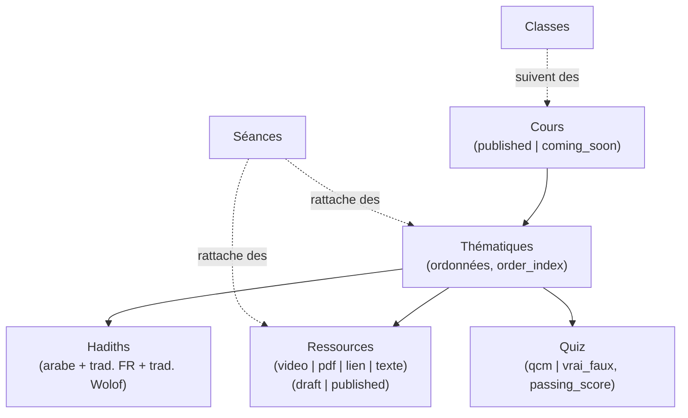

# Modèle métier

## Hiérarchie de contenu

- **Cours** — le plus haut niveau, un programme (ex: "Fiqh du jeûne"). Statut
  `published` ou `coming_soon` (`lib/cours-status.ts`) : `coming_soon` reste
  visible publiquement (annonce) mais sans contenu accessible.
- **Thématiques** — sous-sections d'un cours, ordonnées manuellement via
  `order_index` (drag & drop dans le dashboard, `sortable-reorder-list.tsx` +
  `@dnd-kit`). Pas de statut propre — visibles dès que le cours parent l'est.
- **Ressources** — le contenu consommable dans une thématique : vidéo (URL
  externe), PDF, lien, ou texte libre (markdown, rendu par
  `markdown-content.tsx` / `text-resource-reader.tsx`). Statut
  `draft`/`published` (`lib/ressource-status.ts`) — un brouillon n'apparaît
  jamais côté public, y compris dans les requêtes de progression
  (`markRessourceCompleted` refuse une ressource non `published`, voir
  `lib/actions/progress.ts`).
- **Hadiths** — rattachés à une thématique, pas à une ressource. Toujours en
  arabe + traduction française obligatoire (`translationFr`), traduction
  wolof optionnelle (`translationWolof`) — spécificité du public visé par
  cette plateforme.
- **Quiz** — rattaché à une thématique comme les ressources, statut
  `draft`/`published`. Sert à valider la compréhension (voir
  [Quiz](#quiz) plus bas) et à terminer une étape de la
  [feuille de route](#feuille-de-route). Un quiz en brouillon n'est visible ni
  sur le site ni soumissible (`submitQuizAttempt` le refuse), sinon la
  correction en révélerait les réponses.
- **Séances** — un événement daté (cours en présentiel/live) qui référence
  a posteriori les thématiques et ressources qui y ont été abordées, via les
  tables de jointure `seance_thematiques` / `seance_ressources`. Une séance
  n'est pas un conteneur qui possède du contenu : elle pointe vers du contenu
  qui existe déjà ailleurs.

## Progression utilisateur

`ressource_progress` (table pivot `user_id` + `ressource_id`) enregistre
qu'un utilisateur connecté a marqué une ressource comme terminée
(clic sur le bouton « suivant » en bas de la ressource,
`next-chapter-button.tsx` → `markRessourceCompleted` en
`lib/actions/progress.ts`). Il n'y a pas de décochage. C'est un simple booléen "complété ou non", pas un
pourcentage — l'agrégation (ex: barre de progression d'un cours) se calcule à
la volée en comparant le nombre de ressources publiées d'un cours au nombre
complétées par l'utilisateur (`components/public/progress-ring.tsx`,
`lib/db/queries/progress.ts`). Visible sur `/compte`.

## Quiz

Un quiz (`quiz`) appartient à une thématique et contient des questions
ordonnées (`quiz_questions`, type `qcm` ou `vrai_faux`), chacune avec ses
choix (`quiz_choix`, un ou plusieurs marqués `is_correct`). Édition dashboard
en deux temps : `createQuiz` redirige directement vers
`/dashboard/quiz/[id]/questions` (page dédiée à l'ajout de questions/choix),
contrairement au pattern CRUD standard des autres entités — voir
[`how-to.md`](./how-to.md).

- **Passage** — `/quiz/[id]` (`quiz-attempt.tsx`) affiche les questions,
  collecte les réponses côté client puis les soumet à `submitQuizAttempt`
  (`lib/actions/quiz-tentatives.ts`).
- **Correction côté serveur uniquement** — l'action recharge les
  `is_correct` réels depuis la base à partir des questions du quiz, jamais
  depuis le payload soumis par le client, avant de calculer le score. Une
  question à choix multiples n'est juste que si l'ensemble coché est
  **exactement** l'ensemble des bonnes réponses. Chaque passage crée une
  ligne `quiz_tentatives` (score, total) et des `quiz_reponses` (choix
  cochés par question) — l'historique complet est gardé, pas seulement le
  meilleur score.
- **Score et seuil** — `quiz.passingScore` (0-100, défaut 80) est un seuil en
  pourcentage. `getQuizScores()` (`lib/db/queries/quiz-tentatives.ts`) calcule
  le meilleur score obtenu par un utilisateur sur un quiz ; c'est ce meilleur
  score qui est comparé au seuil, aussi bien pour l'affichage
  (`quiz-item.tsx`, badge vert si un score existe) que pour terminer une étape de
  la [feuille de route](#feuille-de-route).
- **Historique (élève)** — `/compte` liste chaque quiz tenté (meilleur score,
  nombre de tentatives) et renvoie vers `/quiz/[id]/historique`, qui liste
  chronologiquement les tentatives (`getTentativesForQuiz`). Chaque tentative
  ouvre `/quiz/[id]/historique/[tentativeId]` : le détail complet (score,
  correction question par question) via `getTentativeDetail`, le tout scopé
  à l'utilisateur connecté. La correction est rendue par le composant partagé
  `QuizCorrections`, réutilisé aussi juste après la soumission dans
  `quiz-attempt.tsx`.
- **Soumissions (contributeur/admin)** — `/dashboard/quiz/[id]/soumissions`
  affiche, pour un quiz donné : tentatives totales, étudiants distincts,
  score moyen, taux de réussite, et un taux de réussite par question
  (`getQuizQuestionStats`) recalculé depuis les `is_correct` actuels —
  contrairement au `score` stocké sur la tentative (figé au moment du
  passage), ce taux par question reflète toujours le contenu actuel du quiz,
  donc peut diverger si les choix ont été modifiés après coup.
  `getQuizSubmissionStats` regroupe aussi les tentatives par étudiant (une
  ligne par élève avec son meilleur score et la date de sa dernière
  tentative, via `QuizSubmissionsTable`) ; cliquer une ligne ouvre un modal
  listant toutes ses tentatives.

## Feuille de route

L'accueil d'un étudiant est sa **feuille de route**, générée
automatiquement à partir de ses classes (`getStudentRoadmap` dans
`lib/db/queries/roadmap.ts`, rendue par `roadmap-track.tsx`) : les cours de
ses classes, dans l'ordre choisi sur la page de la classe (glisser-déposer,
`class_cours.order_index`), puis les thématiques de chaque cours dans l'ordre
du dashboard. Rien n'est saisi à la main : ajouter une thématique à un cours
l'ajoute à la feuille de route de toutes les classes qui le suivent. Un cours
suivi par deux classes de l'étudiant n'apparaît qu'une fois.

Chaque étape (une thématique) a un état :

- `upcoming` (« À venir », sablier, sans lien) : rien n'y est encore débloqué
  pour sa classe ;
- `completed` (« Terminé ») : tout son contenu publié est débloqué, toutes
  ses leçons sont lues et tous ses quiz réussis (meilleur score ≥
  `passingScore`) ;
- `active` sinon, avec la barre « x/y leçons » qui compte **toutes** les
  leçons publiées de l'étape, débloquées ou non : l'étudiant voit ce qui lui
  reste.

Le seul verrou est le déblocage par l'enseignant : il n'y a plus de
verrouillage d'une étape par le quiz de la précédente. Le staff, qui
n'appartient à aucune classe, voit à la place la liste des cours.

Cette feuille de route remplace les anciens **parcours** (chemins saisis à
la main dans le dashboard), supprimés avec leurs tables par
`0028_class_roadmap_drop_parcours.sql`.

## Recherche

`lib/actions/search.ts` + `lib/db/queries/search.ts` : recherche texte
(`ilike`) tous azimuts sur cours/thématiques/ressources/hadiths/séances en une
seule fonction `searchCatalogue()`, avec filtres optionnels par type
d'entité et par type de ressource (`lib/search-types.ts` définit
`ALL_ENTITY_TYPES` / `ALL_RESSOURCE_TYPES`, la source de vérité pour les
valeurs possibles). UI : `search-command.tsx` (palette de commande, cmdk, ⌘K) +
`/recherche` (page dédiée). La palette désactive le filtrage intégré de cmdk
(`shouldFilter={false}`) : le serveur filtre déjà, et un second filtrage
masquerait des résultats trouvés via la description. Limites connues : la
recherche est sensible aux accents (« priere » ne trouve pas « prière ») et ne
normalise pas l'arabe.

## Lecteur du Coran

Accessible à tous (même sans compte) sur `/coran`, indépendant du reste du contenu (pas de
lien avec `cours`/`thematiques` en base — c'est un module autonome branché
sur l'API externe Quran Foundation).

- **Données** — `lib/quran/client.ts` s'authentifie en OAuth2
  client-credentials auprès de `oauth2.quran.foundation`, puis interroge
  `apis.quran.foundation/content/api/v4`. Les routes internes
  `api/quran/pages/[page]`, `api/quran/chapter-audio/[chapter]`,
  `api/quran/verse-audio/[chapter]`, `api/quran/verse-timings/[chapter]`,
  `api/quran/recitations`, `api/quran/verse-location` exposent ces données au
  client sans jamais lui donner les credentials (`QURAN_CLIENT_ID`/`SECRET`
  restent server-only).
- **Rendu mushaf** — `components/public/quran-reader.tsx` reconstitue une
  page de mushaf authentique (pagination fixe façon Coran papier, pas un flux
  continu), avec la police QCF officielle (`lib/quran/qcf-font.ts`) pour un
  rendu du texte arabe fidèle glyphe par glyphe.
- **Tajweed** — coloration des règles de tajweed directement dans le texte
  rendu, avec une légende (`tajweed-legend.tsx`) expliquant chaque couleur.
- **Audio** — lecture de récitation par chapitre (`quran-audio-player.tsx`,
  affiché en barre plein écran fixée en bas de l'écran), liste de
  récitateurs disponibles via `api/quran/recitations`. Pendant la lecture, le
  verset puis le mot en cours de récitation sont surlignés dans le texte
  (`audioPlayer.activeWordPosition`) : `api/quran/verse-audio` expose les
  `segments` (triplets position/timestamp de début/fin) fournis par l'API
  Quran Foundation pour chaque verset, comparés au temps de lecture courant.
- **Navigation** — passage direct à une sourate (`surah-command.tsx`,
  palette de commande) et navigation page suivante/précédente en gardant la
  continuité de lecture. La dernière page/sourate lue est mémorisée dans le
  `localStorage` du navigateur (pas en base) et reprise automatiquement à
  l'ouverture de `/coran` sans paramètre d'URL explicite.
- **Mode Zen** — bascule plein écran (`ZenDialog`, `@base-ui/react/dialog`)
  qui masque tout sauf le texte et une barre minimale (retour, audio) ; l'état
  activé/désactivé est persisté en `localStorage` (`deenshare:quran-zen-mode`)
  et partagé entre les instances du lecteur ouvertes dans plusieurs onglets
  via `useSyncExternalStore`.

Un utilisateur connecté peut aussi **suivre sa mémorisation** verset par
verset directement depuis le lecteur : clic droit (menu contextuel) sur un
verset pour lui assigner un statut — `en_cours`, `à renforcer` ou `maîtrisé`
(table `quran_memorization`, voir [`database.md`](./database.md)). C'est un
module *séparé* de la progression de cours (`ressource_progress`) : il ne
concerne que le Coran et n'a aucun lien avec `cours`/`thematiques`.

- **Mise à jour verset par verset** — `setVerseMemorizationStatus`
  (`lib/actions/memorization.ts`) fait un simple upsert/delete sur
  `(userId, verseKey)` ; volontairement pas de `revalidatePath` (le lecteur
  met déjà à jour sa carte de statuts de façon optimiste pour rester
  instantané au clic).
- **Mise à jour par comptage** — `setChapterMemorizedCount` permet de déclarer
  "j'ai mémorisé les N premiers versets de cette sourate" en une fois (utilisé
  sur `/memorisation`, la page de synthèse) : les versets `1..N` passent
  `maitrise`, tout ce qui dépasse `N` est effacé — baisser le nombre "rembobine"
  donc réellement la progression au lieu de laisser des versets orphelins.
- **Vue d'ensemble** — `/memorisation` (`memorization-workspace.tsx`) affiche
  d'abord un mini tableau de bord (`memorization-dashboard.tsx` : répartition
  par statut, sourates à renforcer, proches de la maîtrise, activité
  récente), puis `memorization-summary.tsx` qui liste les
  114 sourates avec leur statut agrégé, triable par sourate/statut/nombre de
  versets mémorisés/pourcentage, et permet la saisie rapide par comptage
  décrite ci-dessus. `memorization-progress-bar.tsx` affiche une frise
  verset-par-verset (une cellule = un verset) réutilisée dans le lecteur et
  sur cette page.

### Révision espacée

Les versets `maitrise` entrent dans un cycle de révision espacée (boîtes de
Leitner, `lib/quran/memorization.ts` : `REVIEW_INTERVALS_DAYS = [1, 3, 7, 14,
30]`), stocké sur `quran_memorization.review_box` / `next_review_at` (`null`
pour `en_cours`/`a_renforcer` — ce dernier est toujours dû, pas besoin
d'échéance).

- Un passage manuel à `maitrise` (tap-to-cycle, comptage par sourate)
  (ré)initialise à la boîte 1, échéance demain — sauf pour un verset déjà
  `maitrise` recompté via `setChapterMemorizedCount` : sa progression de
  révision existante est préservée (`coalesce` SQL), pour qu'une simple
  augmentation du compteur ne remette pas tout à zéro.
- **`confirmVerseReview`** (`lib/actions/memorization.ts`) : s'applique à un
  verset `maitrise` **ou** `a_renforcer` dû (sinon erreur). Succès
  (« Je me souviens ») → statut `maitrise`, boîte+1 et échéance repoussée
  (`scheduleNextReview`) — un verset qui était `a_renforcer` repart de la
  boîte 1 (son `review_box` est `null`, traité comme 0). Échec
  (« J'ai oublié ») → statut `a_renforcer`, boîte/échéance effacées (no-op
  si déjà `a_renforcer`).
- **`getDueReviews`/`getDueReviewsSummary`** (`lib/db/queries/quran-memorization.ts`)
  calculent ce qui est dû aujourd'hui : tout `a_renforcer`, plus tout
  `maitrise` dont `next_review_at <= now()`.
- **Page** `/memorisation/revision` (`revision-list.tsx`) : liste groupée
  "à renforcer" / "échéance de révision", chaque ligne a un lien pour relire
  le verset (`/coran?sourate=X&verset=Y`) et les deux boutons « Je me
  souviens » / « J'ai oublié » décrits ci-dessus, pour les deux sections.
- **Cloche du header** (`notification-bell.tsx`, dans `site-header.tsx`,
  désormais un composant serveur `async`) : badge + aperçu du compte dû,
  calculé à chaque chargement de page — pas de table de notifications ni de
  lu/non-lu, juste un résumé live de `getDueReviewsSummary`.

C'est le module le plus complexe du repo en volume de code (plus de 1200
lignes pour le seul composant `quran-reader.tsx`) — à isoler mentalement du
reste pour la partie lecture/audio : elle ne touche ni Drizzle ni Supabase,
seulement l'API Quran Foundation. Seule la mémorisation (statuts par verset,
et sa révision espacée) passe par la base applicative.

## Classes

Une classe (`classes`) regroupe des étudiants du programme (`class_members`)
et suit des cours (`class_cours`) dont l'enseignant débloque les ressources
et les quiz au fil des semaines (`class_ressource_unlocks`,
`class_quiz_unlocks`). Elle ne possède aucun contenu : elle
pointe vers des cours du catalogue, comme une séance. C'est
elle qui détermine ce qu'un étudiant voit, voir
[Accès au contenu](#accès-au-contenu).

- **Gestion réservée aux admins** — `/dashboard/classes` (lien de la sidebar
  visible des seuls admins, pages en `notFound()` sinon) et
  `lib/actions/classes.ts` (`requireAdmin()` partout). Les contributeurs
  gèrent le contenu, pas les listes d'étudiants.
- **Ajout manuel** — `addClassMember` cherche un profil par e-mail
  (insensible à la casse). L'étudiant doit donc s'être connecté au moins une
  fois ; sinon l'action renvoie une erreur qui l'oriente vers le code
  d'invitation. Retirer un membre (`removeClassMember`) ne supprime ni son
  compte ni sa progression.
- **Code d'invitation** — chaque classe reçoit à sa création un code de 8
  caractères (`lib/class-invite.ts`, alphabet sans 0/O ni 1/I/L pour pouvoir
  le dicter). Depuis la page de la classe, l'admin copie le lien
  `/rejoindre/[code]`, génère un nouveau code (l'ancien cesse de
  fonctionner) ou ferme les inscriptions (`invite_enabled`).
- **Cours et déblocage** — sur la page de la classe, l'admin ajoute des cours
  (`addClassCours`), puis débloque leur contenu **ressource par ressource**
  (et quiz par quiz) : une thématique peut s'étaler sur plusieurs mois, on
  ouvre en général une ressource par semaine. Pour chaque thématique :
  « Débloquer la suivante » (`unlockNextRessource`, la première ressource
  verrouillée dans l'ordre du dashboard), « Tout débloquer »
  (`unlockAllInThematique`, ressources et quiz), ou le cadenas d'un élément
  (`setRessourceUnlocked`, `setQuizUnlocked`) pour ouvrir ou refermer.
  - Seuls les éléments **publiés** d'un cours suivi par la classe se
    débloquent ; un brouillon publié plus tard arrive verrouillé.
  - Une thématique sera visible pour la classe dès qu'un de ses éléments est
    débloqué ; ses **hadiths** suivent la thématique, sans déblocage propre.
  - Les déblocages sont propres à chaque classe : un même cours peut être
    suivi par plusieurs classes à des rythmes différents.
  - Retirer un cours (`removeClassCours`) efface ses déblocages pour cette
    classe : le remettre repart d'un cours entièrement verrouillé.
- **Rejoindre** — `/rejoindre` (saisie du code) et `/rejoindre/[code]`. Le
  code est normalisé (majuscules, sans espaces ni tirets). Un visiteur non
  connecté est envoyé vers `/login?next=/rejoindre/CODE` et revient sur la
  page après connexion (et après l'onboarding du nom pour un nouveau
  compte). L'inscription se fait par un bouton (`joinClass`,
  `lib/actions/class-join.ts`), jamais au simple chargement de la page ; elle
  est ouverte à tout utilisateur connecté et idempotente.

## Accès au contenu

Le catalogue est **réservé aux étudiants du programme Bayān**. Seuls l'accueil
(vitrine), `/coran`, `/login` et `/rejoindre` sont ouverts sans compte.

- **Staff** (`admin`, `contributor`) : voit tout, comme avant.
- **Étudiant** (`viewer`) : ne voit que ce qui est débloqué pour l'une de ses
  classes (`lib/auth/content-access.ts` → `getContentAccess()`, calculé une
  fois par requête). Concrètement :
  - les **cours** suivis par ses classes, même si rien n'y est encore
    débloqué (« Le contenu de ce cours sera débloqué au fil des séances ») ;
  - les **ressources** et **quiz** publiés et débloqués ;
  - une **thématique** dès qu'un de ses éléments est débloqué, avec ses
    **hadiths** ;
  - une **séance** si elle référence au moins une thématique ou ressource
    visible, réduite à ce qui l'est ;
  - sa **feuille de route** sur l'accueil, avec les étapes pas encore
    débloquées en « À venir », voir [Feuille de route](#feuille-de-route).
- **Visiteur** : rien. `proxy.ts` le renvoie vers `/login?next=...`.
- **Étudiant sans classe** : l'accueil l'invite à saisir un code
  d'invitation. Inscrit dans une classe qui ne suit encore aucun cours, il
  voit « Ta classe n'a pas encore de cours » (`access.inAnyClass`).

Tout ce qui n'est pas visible répond **404** (« Page introuvable »), titre
d'onglet et image Open Graph compris : on ne révèle pas qu'un contenu existe.
La navigation d'une ressource (« chapitre suivant », examen, sommaire du
cours) ne propose que des éléments débloqués. La recherche (`/recherche` et
⌘K) filtre en SQL selon le même accès. Les Server Actions des étudiants le
vérifient aussi : `markRessourceCompleted` refuse une ressource verrouillée,
`submitQuizAttempt` un quiz verrouillé. `/compte` calcule la progression sur
les seules ressources visibles.

Les helpers de filtrage sont des fonctions pures dans `lib/content-access.ts`
(`canSeeCours`, `canSeeThematique`, `canSeeRessource`, `canSeeQuiz`,
`canSeeSeance`, `visibleItems`), testées dans `content-access.test.ts`. Toute
nouvelle page ou requête qui affiche du contenu doit passer par eux.

## Utilisateurs et rôles

Voir [`auth.md`](./auth.md) pour le détail — en résumé côté modèle : chaque
utilisateur authentifié a une ligne `profiles` (créée automatiquement) avec un
`role` (`admin`/`contributor`/`viewer`) qui conditionne l'accès en écriture,
et une liste de `ressource_progress` qui trace sa lecture.
